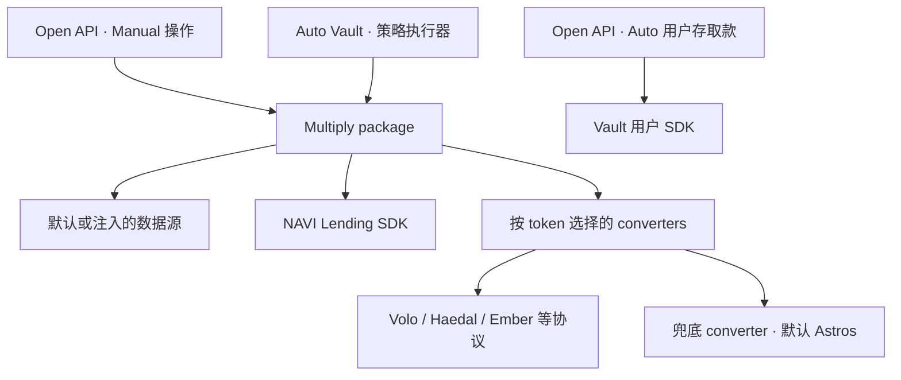

> 本文保留方案讨论。已实现范围、限制和验证结果以本包 README.md 与 docs/verification.md 为准。

# Multiply Package 设计

日期：2026-10-29（Asia/Singapore）  
状态：设计讨论稿，尚未实现或发布  
拟发布包名：`@naviprotocol/multiply`

## 1. 目标与已确定的方向

将 Multiply 的核心策略能力抽离成 npm package，供 Open API 和 Auto Vault 共用。包包含默认链上读取、报价和 PTB 构造能力，同时允许调用方注入数据源。

已确定的方向：

1. Multiply 底层基于 NAVI AccountCap 实现仓位隔离。
2. 公开接口以地址为入口，由包内部解析对应策略的 AccountCap。
3. Snapshot 在包内部获取，不要求调用方获取或传入。
4. 首次开仓没有 AccountCap 时，quote 记录创建意图，build 在同一笔 PTB 中创建并开仓。
5. Multiply Cap 与 Lending 产品注册的 E-Mode Cap 区分；每钱包每策略只允许一个 Multiply Cap，关仓后复用。
6. 策略不绑定 converter。包按 token pair、金额和执行约束选择合适的 converter。
7. `fallbackConverter` 可选，未传时默认使用 Astros Swap Converter。
8. Quote 必须考虑 converter 的实际产出、费用、磨损和滑点，不能按无损兑换计算策略。
9. 包只读取、报价和构造交易；签名、提交、调度和持久化由调用方负责。

以下 TypeScript 用于表达拟议接口，尚不是已发布 SDK 的类型声明。尚未确定的实现决策集中列在第 11 节。

## 2. 职责与调用关系



用户向 Auto Vault 存取款属于 Vault 的份额和请求操作；Vault 将资金投入循环借贷时调用 Multiply package。

| 能力 | Multiply package | 调用方 |
| --- | --- | --- |
| 策略定义 | Market、本金币、抵押币、债务币、适用的 E-Mode | 产品展示、上下架、关联 Vault |
| Cap 管理 | 识别、解析、检查、构造创建操作 | 最终转交钱包或归还 Vault |
| 当前仓位 | Supply、Debt、权益、杠杆、HF | Receipt、份额、历史本金和 PnL |
| 操作规划 | 金额计算、converter 选择、容量与风险校验 | 用户意图、目标杠杆、触发时机 |
| PTB | 追加借贷、转换、还款和保护条件 | 设置 sender/gas、收尾、模拟完整交易 |
| 执行 | 返回可组合的交易结果 | 签名、提交、重试、索引和状态持久化 |
| 产品规则 | 提供链上事实 | Auto/Manual 互斥、鉴权、限流、通知 |

不把现有 Vault 的份额结算、performance fee、交易队列和 signer 一并搬进包。

## 3. 核心模型

### 3.1 通用类型与数值约定

```ts
type Address = string
type CoinType = string
type DecimalString = string

type TokenAmount = {
  coinType: CoinType
  amount: string
}

type PtbCoin = {
  coinType: CoinType
  coin: TransactionObjectArgument
}
```

- `amount` 为链上最小单位整数的十进制字符串。
- 币种 decimals 来自资产配置或数据源，不凭 symbol 推断。
- 杠杆、HF、USD 值使用十进制字符串。
- 内部金额计算使用 `bigint` 或精确十进制工具，不通过 JS `number` 中转。
- 兑换产出向保守方向取整；还款需求、费用预留不能因向下取整而不足。
- Quote 与 converter 的执行数据需要可序列化，不保存 TransactionResult、函数或密钥。

### 3.2 Strategy

```ts
type MultiplyStrategy = {
  id: string
  market: string
  principalCoinType: CoinType
  collateralCoinType: CoinType
  debtCoinType: CoinType
  emodeId?: number
}
```

`id` 是稳定策略标识，应能区分市场、币对和方向，例如 `main-vsui-sui`。展示名称和 npm 版本变化不改变策略身份。

Strategy 不包含 `mode: auto | manual`，也不包含 `conversionAdapter`。Auto/Manual 是产品与控制权的区别；同一循环借贷策略可由用户或 Vault 执行。

具体策略配置的版本校验由内部执行数据记录，避免构造交易时静默套用已经变化的配置。

### 3.3 Action

```ts
type MultiplyAction =
  | { type: 'open'; amount: string; targetLeverage: DecimalString }
  | { type: 'add_principal'; amount: string; targetLeverage?: DecimalString }
  | { type: 'remove_principal'; amount: string }
  | { type: 'set_leverage'; targetLeverage: DecimalString }
  | { type: 'repay'; amount: string }
  | { type: 'add_collateral'; amount: string }
  | { type: 'close' }
```

| Action | 语义 |
| --- | --- |
| `open` | 使用本金币，按目标杠杆建立仓位；允许复用已有空 Cap |
| `add_principal` | 增加本金；默认保持当前杠杆，也可显式指定目标 |
| `remove_principal` | 以期望净取出的本金币金额规划减仓 |
| `set_leverage` | 使用仓位内部资产调整杠杆；额外资金需求必须显式返回 |
| `repay` | 使用调用方提供的债务币还款 |
| `add_collateral` | 使用调用方提供的抵押币补仓 |
| `close` | 规划债务清偿、抵押退出和资金领取 |

这是目标功能集合，不代表首个发布版本已经支持全部操作和协议组合。具体可执行性由 quote 判断。

### 3.4 Constraints

```ts
type MultiplyConstraints = {
  minHealthFactor: DecimalString
  maxSlippageBps: number
}
```

约束与费用是不同概念：协议费用和确定性兑换磨损计入净产出，滑点表示对报价变化的容忍度。

多次转换必须累计其影响并检查整体操作约束。建议将 `maxSlippageBps` 定义为整个计划的预算，由规划器分配给各次转换；不能给每条兑换腿重复分配完整预算。具体分配规则待定。

## 4. 初始化与公开接口

```ts
const multiply = createMultiplyClient({
  client,
  dataSource, // 可选；未传时使用默认链上读取实现
  converters: [
    voloConverter(),
    haedalConverter(),
    // 按已验证的能力注册其他 converter
  ],
  fallbackConverter, // 可选；未传时默认 astrosSwapConverter()
})

await multiply.getPosition(address, { strategy })
await multiply.quote(address, strategy, action, constraints)
await multiply.buildPTB(tx, quote, inputs)
```

`getPosition` 的 `strategy` 可选；不需要过滤时可省略 options。

传入 `fallbackConverter` 时覆盖默认实现。当前不定义 `null` 等禁用兜底的语义。

数据源注入至少覆盖 Cap 解析、仓位、市场配置、价格与风险参数。默认实现支持普通钱包；测试环境可以提供固定数据。Converter 自己所需的协议读取或报价客户端也应允许配置。

## 5. AccountCap 生命周期

### 5.1 数字策略身份

只从 MultiplyRegistry 发现 Cap，两个 u64 为数字策略 ID 与版本：vSUI/SUI=(1,1)，haSUI/SUI=(2,1)，API short SUI=(3,1)。不读取或设置 name/description，不兼容未登记旧 Cap。

Registry 存储 Cap 对象 ID；借贷使用其 accountOwner；交易 sender 是登记钱包。三者分别校验。

### 5.2 与 E-Mode Cap 的区别

保留 E-Mode 产品登记冲突和目标账本检查；当前执行引擎不支持 E-Mode 风险模型。

### 5.3 每钱包每数字组合一个登记

合约拒绝相同 sender 的重复组合。创建 Cap、登记和开仓在同一 PTB 内完成，close 保留登记和空 Cap。SDK 仍校验实际对象、持有者、Cap/accountOwner 重复绑定与仓位。

报价保存 version 3 执行计划、数字 key 与部署；build 重读绑定和仓位，拒绝过期报价。不同钱包写入不按全局对象版本使报价失效。

### 5.4 首次创建与开仓

```text
quote：查询无 Cap → 按空仓计算 → 保存 create 意图

build：创建 Cap → 按固定数字 key 注册 → 追加开仓操作
```

Quote 不创建链上对象。新 Cap 的真实 ID 在执行后确定，quote 中只保存创建意图。

没有 Cap 时仅允许 `open`；其他操作返回 `POSITION_NOT_FOUND`。已有非空仓位时，增加资金使用 `add_principal`。

新 Cap 引用由 build 返回，调用方必须在同一 PTB 中将其转给钱包或纳入自己的容器生命周期。

## 6. getPosition

```ts
getPosition(
  address: Address,
  options?: { strategy?: MultiplyStrategy },
): Promise<MultiplyPosition[]>

type MultiplyPosition = {
  strategyId: string
  market: string
  accountCap: string
  accountOwner: string
  supplies: TokenAmount[]
  borrows: TokenAmount[]
  equityUsd: DecimalString
  healthFactor: DecimalString | null
  leverage: DecimalString | null
}
```

返回值保持数组形状：

- 不传策略：返回钱包全部可识别的 Multiply 仓位。
- 指定策略：正常情况下返回零个或一个。
- 没有 Cap：不伪造空仓记录，返回空数组。
- 已有空 Cap：返回该 Cap 和零余额，便于复用。
- 同策略重复 Cap：报告重复错误。

每个仓位按绑定策略的 market 计算，不能把不同 market 的抵押和债务合并计算 HF。发现不符合策略的资产或其他 market 暴露时，应显式报告，不能忽略后宣称仓位已清空。

无债务时 `healthFactor` 为 `null`；权益非正等不适用情况下，`leverage` 为 `null`。上游读取失败不能伪装成零余额或无 Cap。

当前借贷仓位的基础口径为 `equity = collateralValue - debtValue`、`leverage = collateralValue / equity`。HF 使用对应市场的实际风险规则。Vault 闲置资金、用户份额、延迟领取资产不直接混入这个借贷仓位指标。

## 7. Quote 与内部规划

```ts
quote(
  address: Address,
  strategy: MultiplyStrategy,
  action: MultiplyAction,
  constraints: MultiplyConstraints,
): Promise<MultiplyQuote>

type MultiplyQuote = {
  address: Address
  strategy: MultiplyStrategy
  action: MultiplyAction
  constraints: MultiplyConstraints
  expiresAt: number

  estimate: {
    inputs: TokenAmount[]
    outputs: TokenAmount[]
    healthFactor: DecimalString | null
    leverage: DecimalString | null
  }

  execution: MultiplyExecutionData
}
```

最小返回值的含义：

- `estimate.inputs`：调用方需要提供的资金，排除 gas 和计划内部的 flash loan。
- `estimate.outputs`：整个操作完成后预计可取回的资金，不是某次 converter 的中间产出。
- HF 和杠杆表示本次操作完成后的估计值。
- `execution`：包内部构造交易所需的版本化、可序列化数据，调用方原样保存和传回。
- Snapshot 在内部获取，不要求调用方传入或维护。

`execution` 至少需要承载以下信息，但内部完整结构暂不冻结：

```ts
type AccountCapResolution =
  | { kind: 'existing'; id: string }
  | { kind: 'create' }

// execution.accountCap: AccountCapResolution
// execution.conversions: ConversionQuote[]
// 其余：计划金额、配置/数据版本、执行约束及校验依据
```

不在最小返回值中加入服务端 `quoteId`、完整前后快照、历史 PnL、APY 曲线或数据库状态机。这些不是构造策略操作的必要数据。

### 7.1 报价过程

```text
解析 address + strategy 对应的 Cap
→ 读取仓位、市场配置、价格、利率/费用和容量
→ 初步计算借款、提款、还款和转换金额
→ 选择 converter 并获取报价
→ 使用净产出重新计算抵押、债务、权益和杠杆
→ 必要时调整金额并重新报价
→ 校验最小产出下的 HF、还款能力和其他约束
→ 返回完整操作报价
```

报价算法要有收敛误差和迭代上限；无法得到满足约束的方案时返回不可执行原因，不能无限重试或返回一个不完整计划。

### 7.2 估算与执行边界

- 预计产出用于展示，最低产出用于保守的可执行性检查。
- 开仓和加杠杆要检查最低抵押产出下的借款能力及 HF。
- 减仓和关仓要检查最低兑换产出能否覆盖计划还款、flash loan 本息及相关费用。
- Borrow fee、flash loan fee 与 converter 成本都必须计入；借出的净资金不能直接当作债务总额。
- Quote 不保证未来状态不变。到期时间不得晚于任何依赖的 converter 报价有效期。
- 链上可执行的保护必须写入 PTB；缺少所需保护能力时，不得把单纯的链下估算报告为已落实的保护。

## 8. Converter 机制

### 8.1 注册与选择

策略不绑定 adapter。每一次转换按以下输入独立选择：

```text
coinIn + coinOut + amountIn + 执行约束
```

候选 converter 示例：

| Converter | 负责的转换 |
| --- | --- |
| Volo | SUI 与 vSUI 的协议原生转换 |
| Haedal | SUI 与 haSUI 的协议原生转换 |
| Ember | 经验证支持的 mint/redeem 路线 |
| Astros Swap | 默认兜底的聚合兑换 |

选择顺序：

1. 找到支持对应 token pair 和方向的已注册 converter。
2. 对本次金额获取实际报价，检查最小金额、容量、即时性和约束。
3. 在满足约束的候选中选择保守净产出较好的方案；具体排序细则待定。
4. 没有可用候选时，调用 `fallbackConverter`；未配置则使用 Astros。
5. 兜底也不满足约束时返回不可执行，不放宽用户约束。

Token pair 匹配只表示“可能支持”；可执行性还与方向、金额、协议状态及容量有关。上游错误应保留原因，不能伪装成协议明确不支持。

### 8.2 最小接口

```ts
interface Converter {
  id: string

  supports(coinIn: CoinType, coinOut: CoinType): boolean

  quote(request: {
    coinIn: CoinType
    coinOut: CoinType
    amountIn: string
    slippageBps: number
  }): Promise<ConversionQuote | null>

  buildPTB(
    tx: Transaction,
    quote: ConversionQuote,
    coinIn: TransactionObjectArgument,
    context?: { changeRecipient: string },
  ): Promise<{
    coinOut: TransactionObjectArgument
    change: PtbCoin[]
  }>
}

type ConversionQuote = {
  converterId: string
  input: TokenAmount
  expectedOutput: TokenAmount
  minOutput: TokenAmount
  expiresAt: number
  data: JsonValue
}
```

此接口先表达同笔交易可完成、产出目标 Coin 的转换。无可用路线可返回 `null`；网络或协议读取异常以明确错误表达。

需要地址、收款归属等额外上下文的底层 SDK，由适配层从 Multiply 执行上下文绑定，不在 build 时临时推断钱包，也不把密钥写入 quote。

### 8.3 成本与滑点

- `expectedOutput` 是扣除协议费用、兑换磨损等之后的预计实际产出。
- `minOutput` 是加入允许滑点后要求的最低产出。
- 如果净产出已经包含某项费用，规划器不能再次扣除。
- 多次转换需要传递和累计产出影响，不能假设每一步都拿到理想值。
- 费用拆分、价格影响等展示字段可后续扩展，不是最小报价的必要字段。

转换参数最终以报价锁定的 token、金额和最低产出为准。实际 Coin 多于计划使用量时，必须正确拆分和保留找零，不能未经报价扩大输入。

### 8.4 固定报价构造

选择 converter 和路线发生在 `multiply.quote()`。`buildPTB()` 消费已选择的 converter 报价，不重新选路、不自动回退、不放宽最低产出。

若容量、汇率、路线或报价有效性发生不兼容变化，返回 `QUOTE_STALE` 或相应错误，重新执行完整 Multiply quote。

2026-11-02 更新：Astros 使用已发布的 2.0.7 和默认收费行为。找零直接退给 Multiply 报价中的 `quote.address`，通过 converter 的 `context.changeRecipient` 传递，不从交易 sender 或 gas sponsor 推断。缺失、非法或零地址必须拒绝。Astros 找零不包含在 `built.coins` 中；Auto Vault 接入需要核算此退款规则，或注入符合自身托管规则的 converter。

### 8.5 延迟赎回

延迟赎回不符合当前即时 converter 的返回类型，不得把未来可领取资产当作本次 `coinOut`。

支持这种路线时，需要扩展多阶段计划和 `pendingClaims`，同时分别表达：

- 借款是否已经清偿；
- 资金是否已经全部到账；
- 等待期间是否仍有债务与抵押风险；
- 下一步可执行条件与领取凭证。

Flash loan 必须在当前交易内偿还，不能使用未来到账资产补足。后续阶段需要重新读取和报价，不能沿用数天前的金额与路线。首版是否支持延迟路线尚未确定；未实现时明确返回不支持。

## 9. buildPTB

```ts
buildPTB(
  tx: Transaction,
  quote: MultiplyQuote,
  inputs: MultiplyInputs,
): Promise<MultiplyBuildResult>

type MultiplyInputs = {
  coins: PtbCoin[]
  accountCap?: TransactionObjectArgument
}

type MultiplyBuildResult = {
  coins: PtbCoin[]
  createdAccountCap?: TransactionObjectArgument
}
```

默认通过 `quote.execution.accountCap` 使用已有 Cap 或创建新 Cap。可选的 `inputs.accountCap` 用于 Vault 已从容器取出的同一个 Cap 在当前 PTB 中的引用；它不是更换账户的入口，必须与 quote 的账户绑定一致。

构造步骤：

1. 校验 quote 结构、版本、有效期、策略与 converter 绑定。
2. 重新检查 Cap 解析结果及必要的状态前提。quote 时无 Cap、build 时已有 Cap 时，返回 `QUOTE_STALE`，不继续创建第二个。
3. 校验输入币种、金额和资金需求。
4. 创建或绑定 Cap，追加需要的预言机更新、借贷和 converter 操作。
5. 处理 flash loan 偿还、最小产出和适用的 HF 保护。
6. 返回剩余 Coin 与新 Cap 引用，由调用方完成资产归属收尾。

上述链下重查无法替代链上唯一性约束，也无法消除 build 后到执行前的所有状态变化。

包不设置 sender/gas，不签名、不提交。调用方完成 Cap 转移或归还、资金回收等步骤后，再模拟完整 PTB；单独模拟内部策略片段不能替代完整交易验证。

## 10. 两类调用方的接入

### 10.1 Open API

```text
接收 address / strategy / action / constraints
→ multiply.quote()
→ 缓存完整 quote，给前端返回所需预估
→ 准备资金 Coin，调用 multiply.buildPTB()
→ 处理新 Cap 与输出 Coin 的归属
→ 设置交易参数并模拟完整 PTB
→ 返回未签名交易
```

服务端 quote ID、幂等键、Auto/Manual 互斥、交易确认、历史索引和通知均留在 Open API。

用户用任意其他 Token 支付可先由调用方在同一 PTB 中完成前置兑换，再把本金币传入 Multiply。首版核心聚焦策略内部所需的转换。

### 10.2 Auto Vault

```text
Vault 执行器决定目标操作
→ 使用 Vault 数据源解析持有的 Cap 与仓位
→ multiply.quote()
→ 开始 Vault 操作、取出 Cap 和可用资金
→ multiply.buildPTB()
→ 将 Cap 和剩余资金归还 Vault
→ 完成估值更新、模拟、签名与提交
```

Vault 的 `rebalance` 可转换为 `set_leverage`；触发条件、冷却期和目标杠杆由执行器决定。

钱包式 `getPosition(address)` 的默认发现方式不直接适用于封装在 Vault 容器中的 Cap。Vault 接入必须注入对应的解析与读取实现；多个 Vault 共用一个操作员钱包时，不能把操作员地址误当作这些 Vault 的唯一账户身份。Vault 作用域与公开 `address` 的具体绑定方式仍需在接入设计中确定。

## 11. 待确定事项

| 事项 | 当前状态 |
| --- | --- |
| 唯一性实现 | “每钱包每策略一个 Cap”是要求；仅 SDK/API 检查还是首版加入 Registry，尚未确定 |
| Cap 转移与改名 | 需要定义恢复、归属冲突和登记处理，不能仅依赖当前名称扫描 |
| Vault 账户作用域 | 通过注入数据源支持，但 Vault 身份、地址参数和 Cap 绑定契约待细化 |
| 默认候选 converters | 原生 converter 的注册机制已确定；首版随包预置的候选集合待确定 |
| 候选排序 | 优先符合约束，再比较保守净产出；gas、可靠性及平局规则待细化 |
| 整体滑点预算 | 需要累计控制，多次转换的预算分配算法待确定 |
| 首版协议与操作 | 核心模型覆盖多个动作，但需要明确首批上线的策略/动作组合 |
| 延迟赎回 | 不纳入即时 converter 假设；是否首版支持多阶段计划待确定 |
| 收益与费用展示 | 最小 quote 不包含完整 APY、PnL、费用拆分，后续按产品需求增加 |
| npm 兼容性 | Sui/Lending SDK peer 范围、子入口、发布与迁移方案待实现前确定 |

## 12. 实现验收要点

- 普通 E-Mode 产品 Cap 不会被识别为 Multiply Cap；Multiply 可独立使用 E-Mode 风险参数。
- 首次开仓可以同一 PTB 创建、命名和使用 Cap；空 Cap/关仓 Cap 被复用。
- 同策略重复 Cap 明确报错；若引入 Registry，并发创建由链上检查阻止重复登记。
- Snapshot 完全由包内部读取；注入数据源与默认实现遵守相同语义。
- 策略没有 converter 绑定；同一 token pair 不同金额可以因容量选择不同 converter。
- 没有可用候选时使用兜底；未传兜底实现时使用 Astros；兜底也受同样约束。
- 报价计入 converter 磨损、费用、滑点及借贷费用；最低产出不足时不返回可执行计划。
- 多次转换、大额整数、取整、小额资金、容量不足和报价过期有明确行为。
- Build 使用 quote 中固定的 converter 与路线，失效时不静默换路。
- 延迟领取资产不被当作当前可用 Coin，也不用于偿还当前 flash loan。
- Open API 和 Vault 均验证完整 PTB，包括 Cap 生命周期、零钱归属和必要的链上保护。

## 13. 参考与核查范围

- [Multiply 产品讨论](https://navi-protocol.slack.com/archives/C089YT4EHFW/p1792981236305959)。本文件以本次设计讨论中的最新接口与 converter 决策为准。
- [原 Multiply API 草案](/Users/zado/Downloads/multiply-api-design.md)。该文档描述服务层参考设计，不等同于本包的已确定接口。
- [现有循环策略实现](/Users/zado/code/sui-volo/volo-vault-backend-next/sdk/base_strategy/lst_loop_strategy.ts)：包含循环借贷、调仓、Vault 结算和执行耦合，作为抽离来源。
- [AccountCap 命名源码](/Users/zado/code/navi/protocol/lending_core/sources/account.move:54) 与 [E-Mode SDK](/Users/zado/code/navi/naviprotocol-monorepo/packages/lending/src/emode.ts:68)。命名及注册接口已于本次讨论中通过 Sui 官方 GraphQL 只读核对当前部署接口；未执行创建、注册或开仓交易。
- [Astros 报价与 PTB 示例](https://sdk.naviprotocol.io/swap/example)、[Swap 配置](https://sdk.naviprotocol.io/swap/swap-options)。SDK 的具体重报价、费用和零钱处理仍需在适配实现时验证。

本文件只完成设计整理，没有修改业务实现、发布 npm 包、部署合约或进行链上交易。
